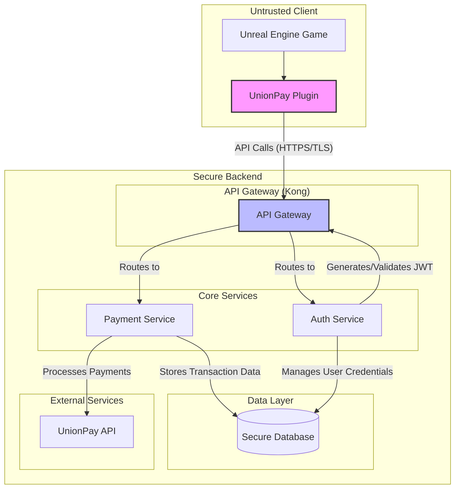
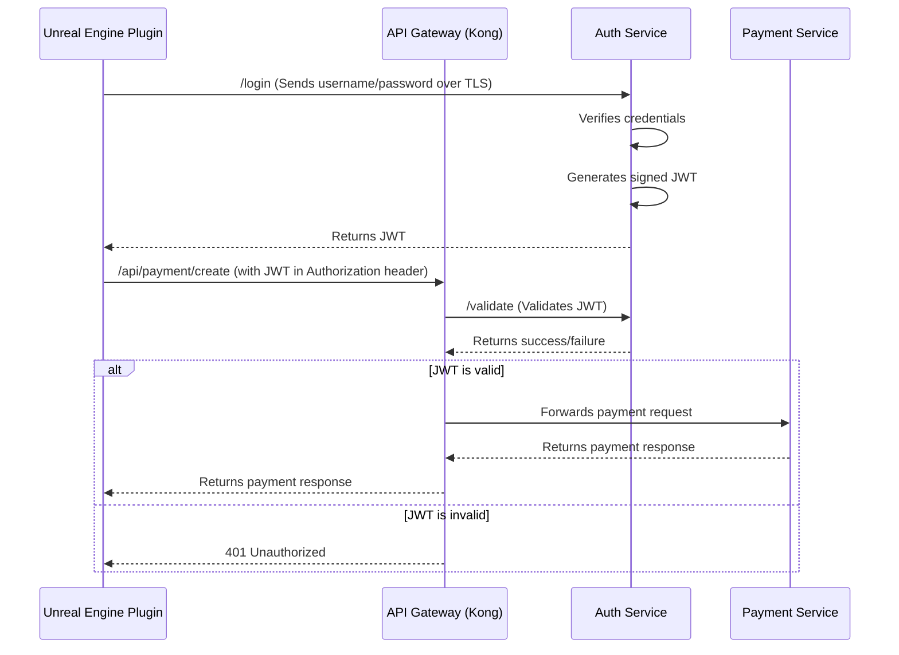

# UnionPay Unreal Engine Plugin - Secure Architecture Design V2

## 1. System Architecture Overview

This document outlines a new, secure architecture for the UnionPay Unreal Engine plugin, designed around a server-authoritative model. The core principle is that the client is untrusted, and all sensitive operations are handled by a secure backend.



## 2. Core Principles

The new architecture is founded on the following security principles:

*   **Server-Authoritative Model**: The backend is the single source of truth. All sensitive operations, including payment processing, data encryption, and session management, must occur exclusively on the server.
*   **Untrusted Client Principle**: The Unreal Engine plugin (the client) is treated as completely untrusted. It has no access to cryptographic keys, secrets, or sensitive operations.
*   **Centralized, Backend-Driven Security**: All security mechanisms, including authentication, encryption, and API protection, are managed and enforced by the backend services.

## 3. Secure Authentication Flow

Authentication is handled entirely by the backend, using a standard token-based system (e.g., OAuth 2.0). The client never handles credentials directly and only receives a short-lived, signed JWT.



## 4. API Gateway (Kong) Responsibilities

The API Gateway is the sole entry point for all client requests and is responsible for:

*   **Authentication Enforcement**: Validating the JWT on every incoming request using a JWT plugin.
*   **SSL/TLS Termination**: Ensuring all communication between the client and the backend is encrypted.
*   **Rate Limiting**: Protecting backend services from abuse and denial-of-service attacks.
*   **Request Routing**: Directing incoming requests to the appropriate backend service (e.g., Auth Service, Payment Service).
*   **CORS Control**: Enforcing cross-origin policies.

## 5. Lean Client Plugin Design

The Unreal Engine plugin is redesigned as a "thin client" with minimal responsibilities:

*   **API Communication**: Making HTTPS API calls to the backend.
*   **Secure Token Storage**: Storing the received JWT securely using the platform's native keychain or keystore.
*   **UI/UX Management**: Presenting the payment UI and handling user input.
*   **Callback Handling**: Managing success, failure, and cancellation callbacks from the backend.

The plugin **must not** perform any of the following:
*   Encryption or decryption.
*   Request signing.
*   Token generation.
*   Secret or key management.

## 6. Simplified `UnionPaySecurityManager` API

The `UnionPaySecurityManager` will be simplified to reflect its new role as a thin client. All functions related to encryption, signing, and token generation will be removed. The new API will focus on managing the authentication token and making API calls.

```cpp
// Simplified UnionPaySecurityManager.h

#pragma once

#include "CoreMinimal.h"
#include "UObject/NoExportTypes.h"
#include "UnionPaySecurityManager.generated.h"

UCLASS(BlueprintType)
class UNIONPAYSECURITY_API UUnionPaySecurityManager : public UObject
{
    GENERATED_BODY()

public:
    /**
     * Initializes the security manager with the backend API endpoint.
     * @param APIEndpoint The base URL of the backend API.
     */
    UFUNCTION(BlueprintCallable, Category = "UnionPay|Security")
    void Initialize(const FString& APIEndpoint);

    /**
     * Authenticates the user with the backend and stores the received JWT.
     * @param Username The user's username.
     * @param Password The user's password.
     * @return True if authentication is successful, false otherwise.
     */
    UFUNCTION(BlueprintCallable, Category = "UnionPay|Security")
    bool Login(const FString& Username, const FString& Password);

    /**
     * Clears the stored authentication token.
     */
    UFUNCTION(BlueprintCallable, Category = "UnionPay|Security")
    void Logout();

    /**
     * Checks if the user is currently authenticated.
     * @return True if a valid JWT is stored, false otherwise.
     */
    UFUNCTION(BlueprintPure, Category = "UnionPay|Security")
    bool IsAuthenticated() const;

    /**
     * Retrieves the stored authentication token.
     * @return The stored JWT, or an empty string if not authenticated.
     */
    UFUNCTION(BlueprintPure, Category = "UnionPay|Security")
    FString GetAuthToken() const;

private:
    /**
     * Stores the JWT securely using the platform's keychain/keystore.
     * @param Token The JWT to store.
     */
    void StoreToken(const FString& Token);

    /**
     * Retrieves the JWT from the platform's keychain/keystore.
     * @return The stored JWT.
     */
    FString RetrieveToken() const;

    /**
     * Deletes the stored JWT.
     */
    void DeleteToken();

    FString BackendAPIEndpoint;
    FString AuthToken;
};
```
