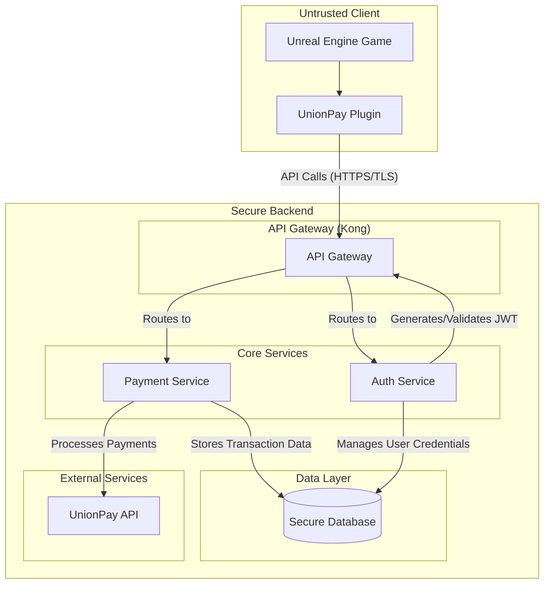

> **Status: prototype, not yet compiled.** The UE 5.1 plugin (`UnionPayPlugin/`) and the Go backend (`backend-services/`) are written but have not been built or run end to end. All credentials in this repo are placeholders. Author: Carlos Shields-Davis.

# UnionPay Unreal Engine Plugin

## 1. Project Overview

This project provides a secure, server-authoritative UnionPay payment plugin for Unreal Engine. The architecture has been refactored to ensure that no sensitive operations occur on the client. The Unreal Engine plugin acts as a thin client, communicating with a secure backend that handles all payment processing, authentication, and data storage. This design mitigates common security risks associated with client-side payment implementations.

## 2. Architecture

The system follows a modern, microservices-based architecture, as detailed in [`Architecture_Design_V2.md`](Architecture_Design_V2.md).

### Architecture Diagram



### Key Services

*   **API Gateway (`api-gateway`)**: The single entry point for all client requests. It handles SSL/TLS termination, authentication enforcement (JWT validation), rate limiting, and routing to the appropriate backend service.
*   **Auth Service (`auth-service`)**: Manages user authentication and generates signed JSON Web Tokens (JWTs) upon successful login.
*   **Payment Service (`payment-service`)**: Handles all payment-related logic, including creating and processing payments, interacting with the UnionPay API, and storing transaction data.
*   **Unreal Engine Plugin**: A thin client responsible for making API calls to the backend, managing the UI, and handling callbacks. It does not contain any sensitive logic or secrets.

## 3. Getting Started

### Backend Setup

The backend services are containerized and can be run easily using Docker Compose.

1.  **Create an Environment File**:
    Copy the example environment file to create your own local configuration:
    ```bash
    cp backend-services/.env.example backend-services/.env
    ```

2.  **Generate Secrets**:
    Open `backend-services/.env` and replace the placeholder values for the following critical secrets. You can use `openssl rand -hex 32` to generate secure random strings.
    *   `JWT_SECRET`
    *   `ENCRYPTION_KEY`
    *   `WEBHOOK_SECRET`

3.  **Run the Services**:
    From the `backend-services` directory, start all services using Docker Compose:
    ```bash
    docker-compose up -d
    ```
    This will build the service images and start all containers, including the API Gateway, backend services, and databases.

### Unreal Engine Plugin Setup

1.  **Add Plugin**: Copy the `UnionPayPlugin` directory into your Unreal Engine project's `Plugins` folder.
2.  **Enable Plugin**: Open your project in the Unreal Editor, go to `Edit > Plugins`, find the "UnionPay" plugin, and enable it. Restart the editor when prompted.
3.  **Configure Backend Endpoint**: In your game's code (e.g., in your `GameInstance` class), get an instance of the `UUnionPayManager` and initialize it with the address of your backend's API Gateway.
    ```cpp
    #include "UnionPayManager.h"

    // Example in a game-specific class
    void AMyPlayerController::BeginPlay()
    {
        Super::BeginPlay();

        UUnionPayManager* UnionPayManager = NewObject<UUnionPayManager>();
        if (UnionPayManager)
        {
            // The default API Gateway port is 8000 (or 8443 for HTTPS)
            UnionPayManager->Initialize(TEXT("http://localhost:8000"));
        }
    }
    ```

## 4. Usage Guide

The following C++ example demonstrates the end-to-end payment flow.

```cpp
#include "UnionPayManager.h"
#include "PaymentTypes.h"

// Assumes you have a UUnionPayManager instance, named UnionPayManager

void HandleAuthenticationSuccess(const FString& JWT)
{
    UE_LOG(LogTemp, Log, TEXT("Authentication successful! JWT: %s"), *JWT);

    // Now that we are authenticated, we can initiate a payment
    FUnionPayPaymentRequest PaymentRequest;
    PaymentRequest.Amount = 100.0; // 100.00
    PaymentRequest.Currency = TEXT("USD");
    PaymentRequest.Description = TEXT("Example Item");
    PaymentRequest.PlayerId = TEXT("player-123");

    // The JWT is handled automatically by the manager
    UnionPayManager->CreatePayment(PaymentRequest);
}

void HandleAuthenticationFailure(const FString& ErrorMessage)
{
    UE_LOG(LogTemp, Error, TEXT("Authentication failed: %s"), *ErrorMessage);
}

void HandlePaymentCompleted(const FString& PaymentId, const FUnionPayPaymentResponse& Response)
{
    UE_LOG(LogTemp, Log, TEXT("Payment %s completed successfully! Transaction ID: %s"), *PaymentId, *Response.TransactionId);
}

void HandlePaymentFailed(const FString& PaymentId, const FUnionPayError& Error)
{
    UE_LOG(LogTemp, Error, TEXT("Payment %s failed: %s"), *PaymentId, *Error.Message);
}

void AMyPlayerController::StartPaymentFlow()
{
    if (!UnionPayManager) return;

    // Bind delegates to handle the asynchronous responses
    UnionPayManager->OnAuthenticationSuccess.AddDynamic(this, &AMyPlayerController::HandleAuthenticationSuccess);
    UnionPayManager->OnAuthenticationFailure.AddDynamic(this, &AMyPlayerController::HandleAuthenticationFailure);
    UnionPayManager->OnPaymentCompleted.AddDynamic(this, &AMyPlayerController::HandlePaymentCompleted);
    UnionPayManager->OnPaymentFailed.AddDynamic(this, &AMyPlayerController::HandlePaymentFailed);

    // 1. Authenticate to get a JWT
    UnionPayManager->Authenticate(TEXT("testuser"), TEXT("password"));
}
```

## 5. Security

The project's security model is **server-authoritative** and treats the game client as **untrusted**.

*   All sensitive operations, including payment processing, interaction with the UnionPay API, and data encryption, are handled exclusively by the backend services.
*   The client **never** has access to API keys, encryption keys, or other secrets.
*   Communication between the client and backend is secured with HTTPS/TLS.
*   Client requests are authenticated using short-lived JWTs, which are validated by the API Gateway before any request is processed by the backend.

## 6. Testing

The project includes a testing suite for both the backend services and the Unreal Engine plugin.

*   **Backend Tests**: The Go services include unit and integration tests. To run them, you can `exec` into the relevant service container and run the tests. For example, for the payment service:
    ```bash
    docker-compose exec payment-service go test ./...
    ```
*   **Plugin Tests**: The Unreal Engine plugin contains automation tests to verify the payment flow. These can be run from the Unreal Editor's `Session Frontend` window under the `Automation` tab. The `FPaymentFlowTest` covers the authentication and payment initiation process.